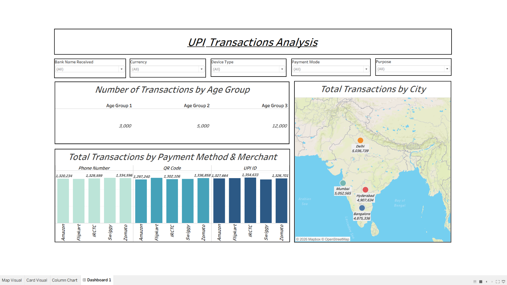

# UPI Transactions Analysis — Tableau Dashboard

## 📊 Project Overview

The **UPI Transactions Analysis Dashboard** is built using Tableau to analyze UPI transaction activity across age groups, cities, payment methods, and merchants.

## 🎯 Project Objectives

- Analyze transactions across different age groups.
- Compare transaction volumes across cities.
- Examine transactions by payment method and merchant.
- Explore UPI transaction patterns using interactive filters.
- Visualize transaction data for business analysis.

## 🛠️ Tools & Technologies

- Tableau Desktop
- Microsoft Excel
- GitHub

## 📂 Dataset

The project uses the `UPI-Transactions.xlsx` dataset.

The dashboard analyzes the following dimensions:

- **Age Groups** — Transaction distribution by age group.
- **Cities** — Transaction distribution across geographical locations.
- **Payment Methods** — Phone Number, QR Code, and UPI ID.
- **Merchants** — Amazon, Flipkart, IRCTC, Swiggy, and Zomato.
- **Filters** — Bank Name Received, Currency, Device Type, Payment Mode, and Purpose.

## 📈 Dashboard Visualizations

### 1. Number of Transactions by Age Group

Compares transaction volumes across different age groups.

### 2. Total Transactions by City

Displays transaction distribution across cities using a geographical map, including Delhi, Mumbai, Hyderabad, and Bangalore.

### 3. Total Transactions by Payment Method & Merchant

Uses a column chart to compare transaction totals across payment methods and merchants.

## 🖼️ Dashboard Screenshots

### Dashboard Overview



## 🎛️ Interactive Filters

The dashboard includes the following filters:

- Bank Name Received
- Currency
- Device Type
- Payment Mode
- Purpose

## 🔍 Key Business Questions

1. How does transaction activity vary across age groups?
2. Which cities have higher transaction volumes?
3. How do transaction totals compare across payment methods?
4. How are transactions distributed across merchants?
5. How can filters help explore transaction patterns?

## 🚀 How to Run the Project

1. Clone or download this repository.
2. Install Tableau Desktop.
3. Open the Tableau workbook.
4. Reconnect the workbook to `UPI-Transactions.xlsx` if prompted.
5. Explore the dashboard and interactive filters.

## 📁 Project Structure

```text
UPI-Transactions-Analysis-Tableau-Dashboard/
├── images/
│   ├── dashboard-overview.png
├── UPI-Transactions.xlsx
├── UPI-Transactions-Analysis.twb
└── README.md
```

## 💡 Skills Demonstrated

- Data Visualization
- Exploratory Data Analysis
- Tableau Dashboard Development
- Geographical Data Visualization
- Transaction Analysis
- Interactive Filtering
- Business Intelligence
- Data Storytelling

## 📌 Conclusion

This project demonstrates how Tableau can transform UPI transaction data into interactive visualizations for exploring transaction volumes, geographical distribution, payment methods, and merchant activity.

## 👤 Author

**Arman Shikalgar**

Aspiring Data Analyst | Python Developer
